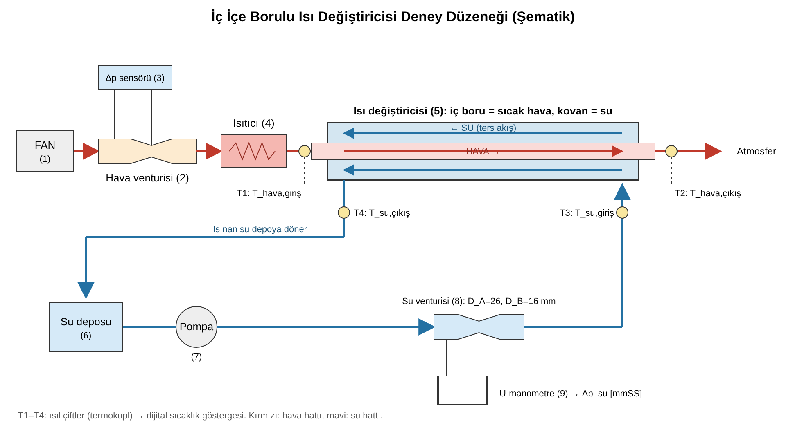

# İç İçe Borulu Isı Değiştiricisi Deney Raporu

**Ders:** MAK 4097 – Ölçüm ve Analiz Laboratuvarı\
**Bölüm:** Dokuz Eylül Üniversitesi, Makina Mühendisliği\
**Deney:** İç İçe (Çift) Borulu Isı Değiştiricisi

> **Önce okuyun: varsayılan değer.** Isı değiştiricisinin ölçüleri düzenekten alınmıştır: $D_1 = 36{,}2$ mm, $D_2 = 42$ mm, $D_3 = 70$ mm, $D_4 = 76$ mm, $L = 1650$ mm. Föyün fotoğraflanan sayfalarında yalnızca **hava venturisinin çapları** yoktur; bunlar için $D_A = 40$ mm, $D_B = 20$ mm **kabul edilmiştir**. Gerçek değerleri föyün Şekil 1'inden alıp `hesap.py` dosyasının başına yazarsanız tüm sonuçlar aynı yöntemle yeniden hesaplanır.

---

## 1. Amaç

Bu deneyde ters akışlı, iç içe borulu bir ısı değiştiricisinde şu adımlar izlenir:

- İç borudan akan sıcak havanın verdiği ısı ve kovandan (dış halka) akan suyun aldığı ısı hesaplanır.
- Logaritmik ortalama sıcaklık farkı (LMTD) kullanılarak toplam ısı geçiş katsayısı $U$ **deneysel olarak** bulunur.
- Reynolds ve Nusselt sayıları ile taşınım katsayıları ($h_{iç}$, $h_{dış}$) belirlenir ve $U$ **teorik (ampirik) olarak** hesaplanır.
- İki $U$ değeri karşılaştırılır ve farkın nedenleri tartışılır.

## 2. Teori

### 2.1 Venturimetre ile debi ölçümü

Sıkıştırılamaz ve sürtünmesiz, yatay bir akış için Bernoulli denklemi şöyledir:

$$\tfrac12\rho V^2 + p = \text{sabit} \qquad (1)$$

Bu denklem venturinin giriş (A) ve boğaz (B) kesitlerine yazılır:

$$\tfrac12\rho V_A^2 + p_A = \tfrac12\rho V_B^2 + p_B \qquad (2)$$

Süreklilik denklemi şudur:

$$\rho A_A V_A = \rho A_B V_B \;\Rightarrow\; V_A = \left(\frac{D_B}{D_A}\right)^2 V_B \qquad (3),(4)$$

(4) denklemi (2)'de yerine konur ve sürtünme kayıpları $C_D$ venturi katsayısıyla düzeltilir. Böylece boğaz hızı elde edilir:

$$V_B = C_D\sqrt{\frac{2\,\Delta p}{\rho\,(1-\beta^4)}}, \qquad \beta = \frac{D_B}{D_A},\quad C_D\approx 0{,}98 \qquad (5)$$

Kütlesel debi $\dot m = \rho A_B V_B$ bağıntısıyla bulunur. Havanın yoğunluğu, föydeki nota göre venturi giriş sıcaklığında ve standart atmosfer basıncında ideal gaz bağıntısından hesaplanır: $\rho = P/(RT)$.

### 2.2 Aktarılan ısı

Kinetik ve potansiyel enerji değişimleri ihmal edilir. Ayrıca sabit özgül ısı kabul edilirse aktarılan ısı şöyle yazılır:

$$q_{hava} = \dot m_{hava}\,c_{p,hava}\,(T_{giriş}-T_{çıkış})_{hava} \qquad (6)$$
$$q_{su} = \dot m_{su}\,c_{p,su}\,(T_{çıkış}-T_{giriş})_{su} \qquad (7)$$

Föye göre iki değer farklı çıkarsa sonraki hesaplarda **hava tarafındaki değer** esas alınır.

### 2.3 Deneysel toplam ısı geçiş katsayısı

$$q = U A\,\Delta T_{lm} \;\Rightarrow\; U = \frac{q}{(2\pi r_2 L)\,\Delta T_{lm}} \qquad (8)\text{–}(10)$$

Burada $A = 2\pi r_2 L$, iki akışkanın birbirine ısı verdiği **iç borunun dış yüzey alanıdır**. Sıcaklık farkı akış boyunca değiştiği için ortalama sürücü kuvvet olarak logaritmik ortalama sıcaklık farkı kullanılır. Ters akışta bu fark şöyle tanımlanır:

$$\Delta T_{lm} = \frac{\Delta T_1-\Delta T_2}{\ln(\Delta T_1/\Delta T_2)},\qquad \Delta T_1 = T_{h,g}-T_{s,ç},\quad \Delta T_2 = T_{h,ç}-T_{s,g} \qquad (11)$$

Ters akışta sıcaklık farkı boru boyunca daha düzgün ve ortalamada daha yüksek kalır. Bu nedenle aynı giriş sıcaklıklarında paralel akışa göre daha fazla ısı aktarılır.

### 2.4 Ampirik bağıntılar

Reynolds sayısı atalet kuvvetlerinin viskoz kuvvetlere oranıdır. Nusselt sayısı ise yüzeydeki boyutsuz sıcaklık gradyanıdır:

$$Re_D = \frac{\rho V D_h}{\mu} \quad (12) \qquad Nu_D = \frac{h D_h}{k} \quad (13)$$

Tam gelişmiş türbülanslı akış için Dittus–Boelter bağıntısı kullanılır:

$$Nu_D = 0{,}023\,Re_D^{4/5}\,Pr^{n},\quad n=0{,}4\ (\text{ısıtma}),\ n=0{,}3\ (\text{soğutma}) \qquad (14)$$

Bağıntının geçerlilik koşulları: $0{,}6\le Pr\le160$, $Re_D\ge10\,000$, $L/D_h\ge10$.

Dairesel kesitte hidrolik çap borunun iç çapına eşittir ($D_h = D_1$). Halkasal bölgede (kovan) hidrolik çap şöyledir:

$$D_h = D_d - D_i = D_3 - D_2 \qquad (15)$$

Isıl direnç devresi kullanılarak aktarılan ısı ve iç borunun dış yüzeyine göre tanımlı toplam ısı geçiş katsayısı yazılır:

$$q = \frac{2\pi L\,\Delta T_{lm}}{\dfrac{1}{h_{iç} r_1}+\dfrac{1}{k_{çelik}}\ln\dfrac{r_2}{r_1}+\dfrac{1}{h_{dış} r_2}} \qquad (16)$$

$$U_{toplam} = \frac{1}{\dfrac{r_2}{r_1 h_{iç}}+\dfrac{r_2}{k_{çelik}}\ln\dfrac{r_2}{r_1}+\dfrac{1}{h_{dış}}} \qquad (17)$$

## 3. Deney Düzeneği

**Şekil 1.** Deney düzeneğinin şematik gösterimi. *(Föyde istenen şema elle de çizilecek. Bileşen adları, sensörler, borular, su ve hava akış yönleri şekil üzerinde işaretlenmelidir.)*

| No | Ekipman | Görevi |
|---|---|---|
| 1 | Fan | Havayı sisteme basar |
| 2 | Hava venturisi | Basınç farkından hava debisini ölçmeyi sağlar |
| 3 | Elektronik (dijital) fark basınç ölçer | Hava venturisindeki $\Delta p$'yi Pa cinsinden ölçer |
| 4 | Elektrikli ısıtıcı | Havayı ısıtır (hava akışı başladıktan **sonra** açılır) |
| 5 | Isı değiştiricisi | İç boru (çelik): sıcak hava; dış boru (kovan): su; ters akış |
| 6 | Su deposu | Ortam sıcaklığındaki suyu sağlar |
| 7 | Pompa | Suyu dolaştırır |
| 8 | Su venturisi ($D_A=26$ mm, $D_B=16$ mm) | Su debisini ölçmeyi sağlar |
| 9 | U-manometre | Su venturisindeki $\Delta p$'yi mmSS cinsinden ölçer |
| T1–T4 | Isıl çiftler (termokupl) ve dijital gösterge | Hava ve suyun giriş/çıkış sıcaklıkları |

## 4. Deneyin Yapılışı

1. Venturilerdeki basınç prizlerinin bağlantıları, manometrelerin terazide olduğu ve sıfır ayarları kontrol edildi.
2. Isıl çiftlerin hava giriş-çıkış ve su giriş-çıkış noktalarına doğru bağlandığı kontrol edildi.
3. Fan ve pompa çalıştırıldı. Hava akışının oluştuğundan emin olunduktan **sonra** ısıtıcılar açıldı. Hava akmazken ısıtıcıyı çalıştırmak rezistansın aşırı ısınmasına yol açar.
4. Sıcaklıkların kararlı hale (sürekli rejim) gelmesi için sistem yaklaşık 10 dakika çalıştırıldı.
5. Basınç farkları ve dört sıcaklık denge durumunda okunup Tablo 1'e işlendi.

## 5. Ölçüm Sonuçları

**Tablo 1.** Deney verileri

| Büyüklük | Değer | Büyüklük | Değer |
|---|---|---|---|
| $T_{hava,giriş}$ | 76,5 °C | $T_{hava,çıkış}$ | 50,2 °C |
| $T_{su,giriş}$ | 22,1 °C | $T_{su,çıkış}$ | 24,7 °C |
| $\Delta p_{hava}$ | 328,7 Pa | $\Delta p_{su}$ | 40 mmSS |
| Su venturisi $D_A$ | 26 mm | Su venturisi $D_B$ | 16 mm |
| $\dot m_{hava}$ | 0,00819 kg/s (hesap, bkz. 6.2) | $\dot m_{su}$ | 0,1884 kg/s (hesap, bkz. 6.3) |

**Tablo 2.** Hesaplarda kullanılan geometri ve sabitler

| Büyüklük | Değer | Kaynak |
|---|---|---|
| $D_1$ (iç boru iç çapı) | 36,2 mm | Düzenek |
| $D_2$ (iç boru dış çapı) | 42 mm | Düzenek |
| $D_3$ (kovan iç çapı) | 70 mm | Düzenek |
| $D_4$ (kovan dış çapı) | 76 mm | Düzenek (hesapta kullanılmaz) |
| $L$ | 1650 mm | Düzenek |
| Hava venturisi $D_A/D_B$ | 40 / 20 mm | **Kabul** |
| $k_{çelik}$ | 60,5 W/m·K | Sade karbon çeliği, 300 K [1, Tablo A.1] |
| $C_D$ | 0,98 | Föy |
| $P_{atm}$, $R_{hava}$ | 101 325 Pa, 287 J/kg·K | Standart atmosfer |

## 6. Hesaplamalar

### 6.1 Termofiziksel özellikler

Özellikler akışkanların **ortalama sıcaklıklarında**, kaynak [1]'in tablolarından doğrusal enterpolasyonla alınmıştır.

**Hava** için ortalama sıcaklık $T_m = (76{,}5+50{,}2)/2 = 63{,}35\ °C = 336{,}5$ K'dir. Değerler Tablo A.4'te 300 K ile 350 K arasından enterpole edildi (oran $= 36{,}5/50 = 0{,}73$):

- $c_p = 1007 + 0{,}73\,(1009-1007) = 1008{,}5$ J/kg·K
- $\mu = [184{,}6 + 0{,}73\,(208{,}2-184{,}6)]\times10^{-7} = 201{,}8\times10^{-7}$ N·s/m²
- $k = [26{,}3 + 0{,}73\,(30{,}0-26{,}3)]\times10^{-3} = 29{,}0\times10^{-3}$ W/m·K
- $Pr = 0{,}707 + 0{,}73\,(0{,}700-0{,}707) = 0{,}702$
- $\rho_m = \dfrac{101325}{287\times336{,}5} = 1{,}049$ kg/m³ (ideal gaz)

**Su** için ortalama sıcaklık $T_m = (22{,}1+24{,}7)/2 = 23{,}4\ °C = 296{,}55$ K'dir. Değerler Tablo A.6'da 295 K ile 300 K arasından enterpole edildi (oran $=0{,}31$):

- $c_p = 4180$ J/kg·K
- $\mu = [959 - 0{,}31\,(959-855)]\times10^{-6} = 926{,}8\times10^{-6}$ N·s/m²
- $k = 0{,}606 + 0{,}31\,(0{,}613-0{,}606) = 0{,}608$ W/m·K
- $Pr = 6{,}62 - 0{,}31\,(6{,}62-5{,}83) = 6{,}375$
- $\rho = 997{,}7$ kg/m³

### 6.2 Hava debisinin hesabı (Tablo 1'deki $\dot m_{hava}$)

Debiler, föyün 5. bölümündeki venturi bağıntısıyla hesaplanmıştır:

$$V_B = C_D\sqrt{\frac{2\,\Delta p}{\rho\,(1-\beta^4)}},\qquad \beta=\frac{D_B}{D_A},\qquad A_B=\frac{\pi D_B^2}{4},\qquad \dot m = \rho\,A_B\,V_B$$

**Veriler:** $\Delta p_{hava} = 328{,}7$ Pa (elektronik ölçerden doğrudan Pa olarak okunduğu için birim çevirmeye gerek yok), $T_{hava,giriş} = 76{,}5$ °C, $C_D = 0{,}98$. Hava venturisinin çapları için $D_A = 40$ mm ve $D_B = 20$ mm **kabul edilmiştir**; gerçek değerler föyün Şekil 1'inden alınmalıdır.

**a) Havanın yoğunluğu.** Föydeki nota göre venturi giriş sıcaklığında ve standart atmosfer basıncında, ideal gaz bağıntısıyla:

$$\rho_{hava} = \frac{P_{atm}}{R\,T} = \frac{101325}{287\times(76{,}5+273{,}15)} = \frac{101325}{287\times349{,}65} = 1{,}0097\ \text{kg/m}^3$$

**b) Çap oranı:**

$$\beta = \frac{D_B}{D_A} = \frac{20}{40} = 0{,}5 \;\Rightarrow\; \beta^4 = 0{,}0625 \;\Rightarrow\; 1-\beta^4 = 0{,}9375$$

**c) Boğaz hızı:**

$$V_B = 0{,}98\sqrt{\frac{2\times328{,}7}{1{,}0097\times0{,}9375}} = 0{,}98\sqrt{\frac{657{,}4}{0{,}9466}} = 0{,}98\sqrt{694{,}5} = 0{,}98\times26{,}35 = 25{,}83\ \text{m/s}$$

**d) Boğaz kesit alanı:**

$$A_B = \frac{\pi D_B^2}{4} = \frac{\pi\,(0{,}020)^2}{4} = 3{,}142\times10^{-4}\ \text{m}^2$$

**e) Kütlesel debi:**

$$\dot m_{hava} = \rho\,A_B\,V_B = 1{,}0097\times3{,}142\times10^{-4}\times25{,}83 = \mathbf{8{,}19\times10^{-3}\ kg/s}$$

### 6.3 Su debisinin hesabı (Tablo 1'deki $\dot m_{su}$)

**Veriler:** $\Delta p_{su} = 40$ mmSS, $D_A = 26$ mm, $D_B = 16$ mm, $C_D = 0{,}98$. Suyun yoğunluğu giriş sıcaklığında (22,1 °C) $\rho = 997{,}8$ kg/m³ alınmıştır.

**a) Basınç farkının Pa'ya çevrilmesi.** $1\ \text{mmSS} = \rho g h = 1000\times9{,}81\times0{,}001 = 9{,}81$ Pa olduğundan:

$$\Delta p_{su} = 40\times9{,}81 = 392{,}4\ \text{Pa}$$

**b) Çap oranı:**

$$\beta = \frac{D_B}{D_A} = \frac{16}{26} = 0{,}6154 \;\Rightarrow\; \beta^4 = 0{,}6154^4 = 0{,}1434 \;\Rightarrow\; 1-\beta^4 = 0{,}8566$$

**c) Boğaz hızı:**

$$V_B = 0{,}98\sqrt{\frac{2\times392{,}4}{997{,}8\times0{,}8566}} = 0{,}98\sqrt{\frac{784{,}8}{854{,}7}} = 0{,}98\sqrt{0{,}9182} = 0{,}98\times0{,}9582 = 0{,}9391\ \text{m/s}$$

**d) Boğaz kesit alanı:**

$$A_B = \frac{\pi D_B^2}{4} = \frac{\pi\,(0{,}016)^2}{4} = 2{,}011\times10^{-4}\ \text{m}^2$$

**e) Kütlesel debi:**

$$\dot m_{su} = \rho\,A_B\,V_B = 997{,}8\times2{,}011\times10^{-4}\times0{,}9391 = \mathbf{0{,}1884\ kg/s}$$

Hacimsel olarak bu debi $\dot m/\rho = 1{,}89\times10^{-4}$ m³/s, yani yaklaşık 11,3 L/dk eder.

**Not:** Su debisi tamamen ölçülen değerlerle hesaplandığı için kesindir. Hava debisi ise kabul edilen venturi çaplarına bağlıdır; gerçek $D_A$ ve $D_B$ ile yeniden hesaplanmalıdır.

### 6.4 Hava ve su tarafında aktarılan ısı (İstenen 2)

Hava tarafı:

$$q_{hava} = 8{,}19\times10^{-3}\times1008{,}5\times(76{,}5-50{,}2) = 8{,}19\times10^{-3}\times1008{,}5\times26{,}3 = \mathbf{217{,}3\ W}$$

Su tarafı:

$$q_{su} = 0{,}1884\times4180\times(24{,}7-22{,}1) = 0{,}1884\times4180\times2{,}6 = \mathbf{2047{,}7\ W}$$

İki değerin oranı $q_{su}/q_{hava} \approx 9{,}4$'tür. Suyun çektiği ısı, havanın verdiği ısıdan yaklaşık 9 kat büyük hesaplanmıştır. Föy gereği sonraki hesaplarda $q = q_{hava} = 217{,}3$ W esas alınmıştır.

### 6.5 İki değer arasındaki farkın nedenleri (İstenen 3)

Fiziksel olarak sıcak hava iç borudadır ve dış ortamla doğrudan temas etmez. Bu nedenle ideal durumda havanın verdiği ısının tamamı suya geçer ve $q_{hava} \approx q_{su}$ olmalıdır. Hesaplanan büyük farkın başlıca nedenleri şunlardır:

1. **Su tarafındaki sıcaklık farkı çok küçük.** Su debisi yüksek, ısıl kapasite oranı ise $C_{su}/C_{hava} = 787{,}6/8{,}26 \approx 95$'tir. Bu yüzden su yalnızca 2,6 K ısınmıştır. Isıl çiftlerin tipik doğruluğu ±0,5–1 K mertebesindedir. Ölçülen 2,6 K'lik fark, bu belirsizlikle aynı mertebededir; tek bir ısıl çiftteki 1 K'lik hata, $q_{su}$'yu ~%40 değiştirir. Enerji dengesinin sağlanması için suyun yalnızca $\Delta T = 217{,}3/(0{,}1884\times4180) = 0{,}28$ K ısınması yeterliydi. Yani su tarafı ölçümü bu debide hassas değildir. Föyün hava tarafını esas almasının nedeni de budur: havada $\Delta T = 26{,}3$ K olduğundan bağıl ölçüm hatası çok küçüktür.
2. **Kovanın çevreyle ısı alışverişi.** Su ortam sıcaklığına yakındır (22–25 °C). Kovan yalıtımsızsa su, ortamdan ve ısıtıcı/fan çevresindeki sıcak yüzeylerden de ısı alabilir. Bu ek ısı da $q_{su}$'ya eklenir.
3. **Pompa işi ve su deposu.** Pompanın verdiği enerjinin bir kısmı sürtünmeyle ısıya dönüşür. Ayrıca kapalı devrede depo sıcaklığı zamanla yükselebilir. Giriş sıcaklığı ölçüm sırasında sabit değilse sürekli rejim kabulü bozulur.
4. **Kararlı hale tam ulaşılamaması.** 10 dakikalık bekleme süresi, kovan ve borunun ısıl kütlesi için yetersiz kalmış olabilir. Bu durumda okunan sıcaklıklar anlık değerlerdir.
5. **Isıl çiftlerin konumu.** Isıl çift akış merkezinde değil de boru cidarına yakın veya metal bağlantı parçasına temas eden bir konumdaysa, ölçülen değer karışım (bulk) sıcaklığını tam yansıtmaz.
6. **Debi ölçümündeki belirsizlikler.**
   - $C_D = 0{,}98$ standart venturi için yaklaşık bir değerdir.
   - U-manometrede ±1 mmSS okuma hatası $\dot m_{su}$'da ~%1,3 hata yapar.
   - Hava venturisi boyutları raporda kabul edilmiştir. Bu boyutlar $\dot m_{hava}$'yı ve dolayısıyla $q_{hava}$'yı doğrudan etkiler. Gerçek boyutlar girildiğinde fark değişecektir.
7. **Hava yoğunluğu hesabı.** Gerçek atmosfer basıncı ve hattaki statik basınç standart değerden farklıdır. Havanın nemi de ihmal edilmiştir.

### 6.6 Logaritmik ortalama sıcaklık farkı ve deneysel U (İstenen 4)

Ters akış için uç sıcaklık farkları:

$$\Delta T_1 = T_{hava,g} - T_{su,ç} = 76{,}5 - 24{,}7 = 51{,}8\ \text{K}$$
$$\Delta T_2 = T_{hava,ç} - T_{su,g} = 50{,}2 - 22{,}1 = 28{,}1\ \text{K}$$

Logaritmik ortalama sıcaklık farkı:

$$\Delta T_{lm} = \frac{51{,}8-28{,}1}{\ln(51{,}8/28{,}1)} = \frac{23{,}7}{\ln 1{,}8434} = \frac{23{,}7}{0{,}6116} = \mathbf{38{,}75\ K}$$

Isı transfer alanı (iç borunun dış yüzeyi):

$$A_2 = 2\pi r_2 L = \pi D_2 L = \pi\times0{,}042\times1{,}65 = 0{,}2177\ \text{m}^2$$

Deneysel toplam ısı geçiş katsayısı, hava tarafındaki ısı esas alınarak:

$$U_{deneysel} = \frac{q_{hava}}{A_2\,\Delta T_{lm}} = \frac{217{,}3}{0{,}2177\times38{,}75} = \frac{217{,}3}{8{,}436} = \mathbf{25{,}8\ W/m^2K}$$

Karşılaştırma için: $q_{su}$ esas alınsaydı $U = 2047{,}7/8{,}436 \approx 243$ W/m²K çıkardı. Bu değer, teorik hesaptaki hava tarafı direncinin izin verdiği üst sınırın ($h_{iç}$ ≈ 35 W/m²K, bkz. 6.8) çok üzerindedir; fiziksel olarak mümkün değildir. Bu da hava tarafının esas alınmasının doğru olduğunu gösterir.

### 6.7 Reynolds sayıları (İstenen 5)

**Hava (iç boru, dairesel kesit, $D_h = D_1 = 36{,}2$ mm).**

Kesit alanı:

$$A_1 = \frac{\pi D_1^2}{4} = \frac{\pi\,(0{,}0362)^2}{4} = 1{,}029\times10^{-3}\ \text{m}^2$$

Ortalama hız (ortalama sıcaklıktaki yoğunlukla):

$$V_{hava} = \frac{\dot m}{\rho_m A_1} = \frac{8{,}19\times10^{-3}}{1{,}049\times1{,}029\times10^{-3}} = 7{,}59\ \text{m/s}$$

Reynolds sayısı:

$$Re_{hava} = \frac{\rho V D_1}{\mu} = \frac{1{,}049\times7{,}59\times0{,}0362}{201{,}8\times10^{-7}} = \frac{4\dot m}{\pi D_1 \mu} = \frac{4\times8{,}19\times10^{-3}}{\pi\times0{,}0362\times201{,}8\times10^{-7}} = \mathbf{14\,280}$$

$Re > 10\,000$ olduğundan akış türbülanslıdır.

**Su (halkasal bölge).** Hidrolik çap ve kesit alanı:

$$D_h = D_3 - D_2 = 70 - 42 = 28\ \text{mm}$$
$$A_{halka} = \frac{\pi}{4}(D_3^2 - D_2^2) = \frac{\pi}{4}(0{,}070^2-0{,}042^2) = \frac{\pi}{4}\times3{,}136\times10^{-3} = 2{,}463\times10^{-3}\ \text{m}^2$$

Ortalama hız:

$$V_{su} = \frac{\dot m_{su}}{\rho A_{halka}} = \frac{0{,}1884}{997{,}7\times2{,}463\times10^{-3}} = 0{,}0767\ \text{m/s}$$

Reynolds sayısı:

$$Re_{su} = \frac{\rho V D_h}{\mu} = \frac{997{,}7\times0{,}0767\times0{,}028}{926{,}8\times10^{-6}} = \mathbf{2\,310}$$

$Re \approx 2300$ olduğundan su akışı **laminer–geçiş sınırındadır**. Halkanın kesiti geniş olduğu için su çok yavaş (≈ 7,7 cm/s) akmaktadır.

### 6.8 Nusselt sayıları ve taşınım katsayıları (İstenen 6)

**İç boru, hava soğuyor → $n = 0{,}3$:**

$$Nu_{hava} = 0{,}023\,(14\,280)^{0{,}8}(0{,}702)^{0{,}3} = 0{,}023\times2107\times0{,}8994 = \mathbf{43{,}6}$$

$$h_{iç} = \frac{Nu\,k}{D_1} = \frac{43{,}6\times0{,}0290}{0{,}0362} = \mathbf{34{,}9\ W/m^2K}$$

**Halka, su ısınıyor → $n = 0{,}4$ (föydeki Dittus–Boelter bağıntısı):**

$$Nu_{su} = 0{,}023\,(2\,310)^{0{,}8}(6{,}375)^{0{,}4} = 0{,}023\times490{,}7\times2{,}098 = \mathbf{23{,}7}$$

$$h_{dış} = \frac{Nu\,k}{D_h} = \frac{23{,}7\times0{,}608}{0{,}028} = \mathbf{514\ W/m^2K}$$

Su tarafında $Re \approx 2300$ olduğu için Dittus–Boelter'in geçerlilik aralığının çok dışındayız (Gnielinski bağıntısı da ancak $Re \ge 3000$ için geçerlidir). Bu nedenle kontrol amacıyla **laminer, tam gelişmiş halkasal akış** için de hesap yapılmıştır. İç yüzeyden ısıtılan, dış yüzeyi yalıtılmış halka için Nusselt sayısı [1, Tablo 8.2]'den $D_i/D_o = 42/70 = 0{,}60$ değerinde enterpolasyonla alınır:

$$Nu_i = 5{,}74 + \frac{0{,}60-0{,}50}{1{,}00-0{,}50}\,(4{,}86-5{,}74) = 5{,}56$$

$$h_{dış,lam} = \frac{5{,}56\times0{,}608}{0{,}028} = 121\ \text{W/m}^2\text{K}$$

Gerçek değer bu iki sınır (121–514 W/m²K) arasındadır. Geçiş bölgesindeki akışta Dittus–Boelter $h$'yi olduğundan büyük tahmin eder.

### 6.9 Teorik toplam ısı geçiş katsayısı (İstenen 7)

Yarıçaplar: $r_1 = 18{,}1$ mm, $r_2 = 21$ mm. Denklem (17)'deki terimler (iç borunun dış yüzeyine göre, m²K/W, $h_{dış}$ Dittus–Boelter ile):

| Direnç terimi | Hesap | Değer | Pay |
|---|---|---|---|
| İç taşınım $\dfrac{r_2}{r_1h_{iç}}$ | $\dfrac{0{,}021}{0{,}0181\times34{,}9}$ | $3{,}323\times10^{-2}$ | %94,3 |
| Cidar iletimi $\dfrac{r_2}{k}\ln\dfrac{r_2}{r_1}$ | $\dfrac{0{,}021}{60{,}5}\ln\dfrac{21}{18{,}1}$ | $5{,}16\times10^{-5}$ | %0,15 |
| Dış taşınım $\dfrac{1}{h_{dış}}$ | $\dfrac{1}{514}$ | $1{,}944\times10^{-3}$ | %5,5 |
| **Toplam** | | $3{,}523\times10^{-2}$ | |

$$U_{teorik} = \frac{1}{3{,}523\times10^{-2}} = \mathbf{28{,}4\ W/m^2K}$$

Denklem (16) ile teorik ısı akışı:

$$q_{teorik} = U A_2 \Delta T_{lm} = 28{,}4\times0{,}2177\times38{,}75 = 239{,}5\ \text{W}$$

Su tarafı için laminer değer ($h_{dış} = 121$ W/m²K) kullanılırsa dış direnç $8{,}27\times10^{-3}$ m²K/W olur (toplamın %20'si) ve $U_{teorik} = 24{,}1$ W/m²K bulunur. Yani teorik U, su tarafındaki belirsizliğe bağlı olarak **24,1–28,4 W/m²K** aralığındadır.

**Bağıntı koşullarının kontrolü:**

| Koşul | Hava (iç boru) | Su (halka) |
|---|---|---|
| $0{,}6\le Pr\le160$ | $Pr=0{,}702$ ✔ | $Pr=6{,}375$ ✔ |
| $Re\ge10\,000$ | $Re=14\,280$ ✔ | $Re=2\,310$ ✘ (laminer–geçiş sınırı) |
| $L/D_h\ge10$ | $L/D_1 = 1{,}65/0{,}0362 = 45{,}6$ ✔ | $L/D_h = 1{,}65/0{,}028 = 58{,}9$ ✔ |

Hava tarafı Dittus–Boelter'in tüm koşullarını sağlar. Su tarafında Reynolds koşulu **sağlanmamaktadır**: su debisi halkanın geniş kesitine (2,46×10⁻³ m²) göre küçük olduğundan hız düşük, suyun viskozitesi de yüksektir. Bu yüzden akış türbülanslı değildir ve Dittus–Boelter su tarafında $h$'yi olduğundan büyük verir. Ancak toplam direncin büyük kısmı hava tarafında olduğundan, bu hatanın $U_{teorik}$ üzerindeki etkisi sınırlıdır (%15). Ayrıca Dittus–Boelter dairesel boru için türetilmiştir; halkasal kesitte hidrolik çap yaklaşımı yaklaşık sonuç verir [1, Bölüm 8.6]. Laminer bölgede tam gelişmiş akış için gereken giriş uzunluğu da ($x_{fd,t} \approx 0{,}05\,Re\,Pr\,D_h \approx 0{,}05\times2310\times6{,}4\times0{,}028 \approx 20$ m) boru boyundan çok büyüktür; yani su tarafında akış ısıl olarak gelişmekte olan bölgededir ve gerçek $h$ tam gelişmiş laminer değerden yüksektir.

**Deneysel ve teorik U'nun karşılaştırılması:**

$$\frac{U_{teorik}-U_{deneysel}}{U_{teorik}} = \frac{28{,}4-25{,}8}{28{,}4} = \%9{,}3$$

Deneysel değer, föydeki Dittus–Boelter ile bulunan teorik değerden yaklaşık %9 düşüktür ve laminer kabulle bulunan alt sınırdan (24,1 W/m²K) biraz yüksektir; yani **deneysel U, teorik aralığın içindedir**. Dittus–Boelter'in kendi belirsizliğinin ±%25 mertebesinde olduğu [1] düşünülürse uyum iyidir. Kalan farkın olası nedenleri:

- **Su tarafının rejimi:** Su tarafı türbülanslı kabul edilerek hesaplanmıştır; gerçekte akış laminer–geçiş bölgesindedir ve $h_{dış}$ daha düşüktür. Bu tek başına farkın büyük kısmını açıklar.
- **Kirlilik (fouling) direnci:** Kullanılmış bir düzenekte çelik borunun su tarafında kireç/pas, hava tarafında is/toz birikir. Bu ek dirençler teorik hesapta yoktur.
- **Ampirik bağıntıların belirsizliği:** Dittus–Boelter ±%25 belirsizlik taşır; halkasal kesit için hidrolik çap yaklaşımı da ayrıca hata getirir.
- **Özellik değişimi:** Hava 26 K soğurken $\mu$, $k$ ve $\rho$ değişir. Ortalama sıcaklıkta özellik almak bir yaklaşımdır.
- **Ölçüm hataları:** $U_{deneysel}$ doğrudan $\dot m_{hava}$'ya bağlıdır. Hava venturisi boyutlarının kabulü, $C_D$ ve ısıl çift hataları bu değeri etkiler.
- **Isı kayıpları ve geometri:** Havanın ısıtıcı ile ısı değiştirici arasındaki borularda çevreye ısı vermesi, uçlardaki bağlantı parçaları ve iç borunun kovan içinde tam merkezde olmaması (eksantriklik) gerçek ısı geçişini değiştirir.

### 6.10 Sistemin uygulanabilirliği (İstenen 8)

- **Hava tarafı kontrol eder.** Toplam direncin %80–95'i hava tarafındadır ($h_{iç}\approx35 \ll h_{dış}\approx121$–514 W/m²K). Bu nedenle $U$, $h_{iç}$'nin altında kalır. Cidar direnci (%0,15) ihmal edilebilir; boru malzemesini (ör. bakıra) değiştirmek anlamlı bir kazanç sağlamaz.
- **Etkinlik düşüktür.** $C_{min} = C_{hava} = 8{,}26$ W/K ve $C_r = 0{,}0105$'tir. Etkinlik $\varepsilon = q/[C_{min}(T_{h,g}-T_{s,g})] = 217{,}3/(8{,}26\times54{,}4) = 0{,}48$, $NTU = UA/C_{min} = 25{,}8\times0{,}2177/8{,}26 = 0{,}68$'dir. Hava, suyun sıcaklığına yaklaşamadan (50 °C) çıkmaktadır.
- **Gereken alan büyüktür.** $U\approx24$–28 W/m²K değerleri, gaz-sıvı ısı değiştiricileri için literatürdeki tipik aralığın (10–250 W/m²K [1, Tablo 11.2]) alt kısmındadır. Örneğin $\varepsilon=0{,}9$ için $NTU = -\ln(1-0{,}9) \approx 2{,}3$ gerekir; bu da mevcut borudan yaklaşık 3,4 kat uzun, yani ≈ 5,6 m'lik bir ısı değiştirici demektir.
- **İyileştirme önerileri:**
  - Hava tarafına kanat (fin) eklemek ya da iç boruya türbülatör/burgulu şerit yerleştirmek $h_{iç}$'yi ve alanı artırır. En etkili iyileştirme budur.
  - Hava hızı (≈ 7,6 m/s) artırılabilir; $h_{iç} \propto Re^{0,8}$ olduğundan hava debisini iki katına çıkarmak $h_{iç}$'yi ~%74 artırır. Bunun bedeli basınç kaybı ve fan gücüdür.
  - Su tarafında hız çok düşüktür (≈ 7,7 cm/s). Halka aralığını daraltmak veya su debisini artırmak akışı türbülanslı yapar; ancak su tarafı kontrol etmediği için kazanç sınırlıdır.
  - Su debisi azaltılırsa su $\Delta T$'si büyür ve su tarafı ölçüm hassasiyeti artar, enerji dengesi daha güvenilir kontrol edilir.
  - Kovanın dışı yalıtılmalı, ölçümler daha uzun bir dengeye ulaşma süresinden sonra yapılmalıdır.
- **Sonuç:** Mevcut sistem, küçük ısıl yüklerde (yüzlerce W) gazdan sıvıya ısı geri kazanımı veya eğitim amaçlı kullanım için uygundur. Yüksek kapasiteli endüstriyel hava-su uygulamaları için kanatlı borulu ya da gövde-borulu ısı değiştiriciler daha uygundur.

## 7. Sonuç Tablosu

| Büyüklük | Değer |
|---|---|
| $\dot m_{hava}$ | 8,19×10⁻³ kg/s |
| $\dot m_{su}$ | 0,1884 kg/s |
| $q_{hava}$ / $q_{su}$ | 217,3 W / 2047,7 W |
| $\Delta T_{lm}$ | 38,75 K |
| $A_2$ | 0,2177 m² |
| $Re_{hava}$ / $Re_{su}$ | 14 280 / 2 310 |
| $Nu_{hava}$ / $Nu_{su}$ | 43,6 / 23,7 |
| $h_{iç}$ / $h_{dış}$ | 34,9 / 514 W/m²K |
| $U_{deneysel}$ | 25,8 W/m²K |
| $U_{teorik}$ (Dittus–Boelter) | 28,4 W/m²K |
| $U_{teorik}$ (su tarafı laminer) | 24,1 W/m²K |
| Fark (Dittus–Boelter'e göre) | %9,3 |
| Etkinlik $\varepsilon$ / NTU | 0,48 / 0,68 |

Deneyde hava tarafından 217 W ısı suya aktarılmış, deneysel toplam ısı geçiş katsayısı 25,8 W/m²K bulunmuştur. Ampirik bağıntılarla hesaplanan teorik değer 28,4 W/m²K'dir (su tarafı laminer kabul edilirse 24,1 W/m²K). Aradaki ~%9'luk fark; su tarafının türbülanslı değil laminer–geçiş rejiminde olması, bağıntı belirsizlikleri, kirlilik direnci ve ölçüm/kabul belirsizlikleriyle açıklanabilir. Su tarafı ısı hesabındaki büyük sapma, yüksek su debisi nedeniyle çok küçük kalan sıcaklık farkının (2,6 K) ısıl çift hassasiyetine yakın olmasından kaynaklanır. Isı değiştiricinin performansını hava tarafı taşınımı belirlemektedir.

## 8. Kaynakça

[1] Incropera, F. P., DeWitt, D. P., Bergman, T. L., & Lavine, A. S. (2007). *Fundamentals of Heat and Mass Transfer* (6th ed.). John Wiley & Sons. Tablo A.1 (çelik), A.4 (hava), A.6 (doymuş su), Denk. 8.60 (Dittus–Boelter), Tablo 8.2 (laminer halkasal akış), Tablo 11.2 (tipik U değerleri).

[2] DEÜ Makina Mühendisliği Bölümü, *MAK 4097 Ölçüm ve Analiz Laboratuvarı – İç İçe Borulu Isı Değiştiricisi Deney Föyü*.

[3] Çengel, Y. A., & Ghajar, A. J. (2015). *Heat and Mass Transfer: Fundamentals and Applications* (5th ed.). McGraw-Hill. Bölüm 11 (Isı değiştiricileri), Bölüm 8 (boru içi akış).

---

*Not: Tüm sayısal sonuçlar `hesap.py` betiğiyle üretilmiştir. Varsayılan geometrik değerler değiştirildiğinde betiği `python3 hesap.py` ile yeniden çalıştırıp çıktıdaki değerleri rapora aktarın.*
